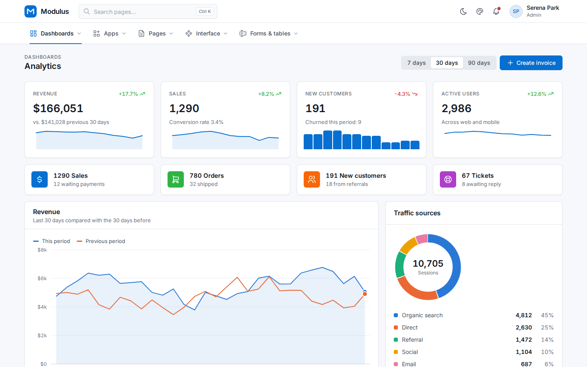
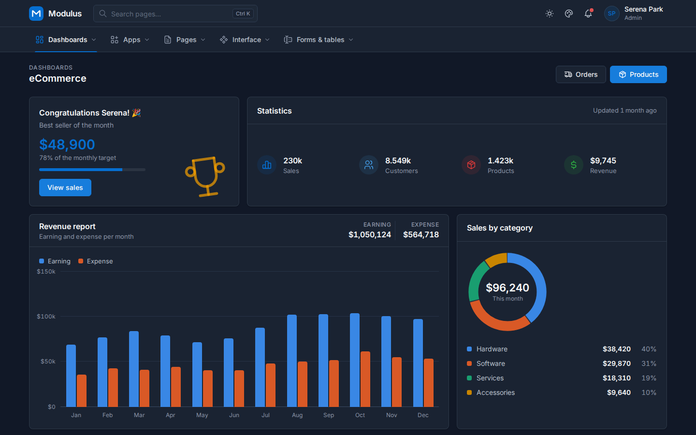
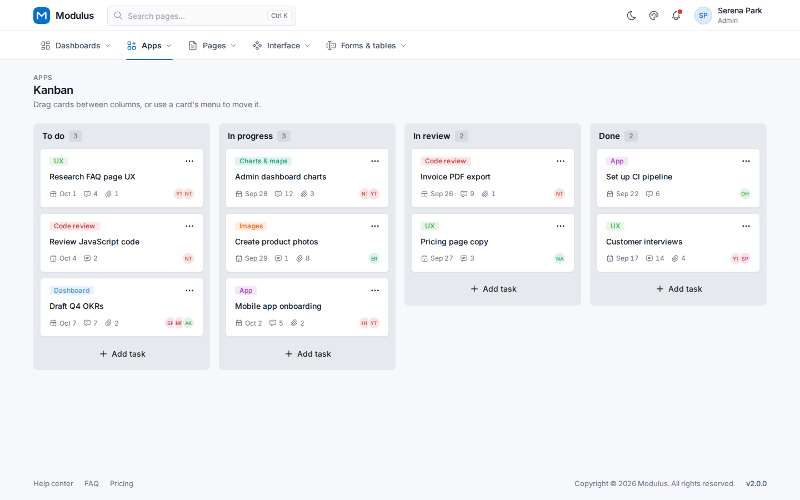
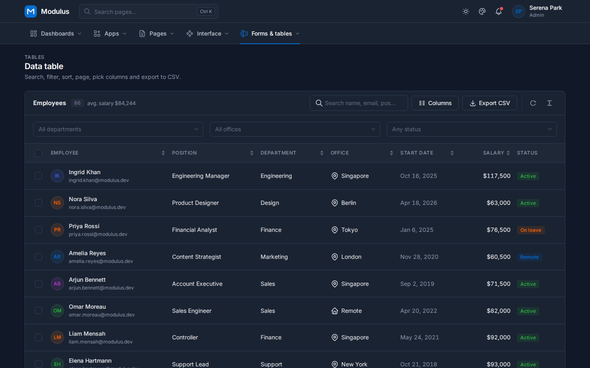
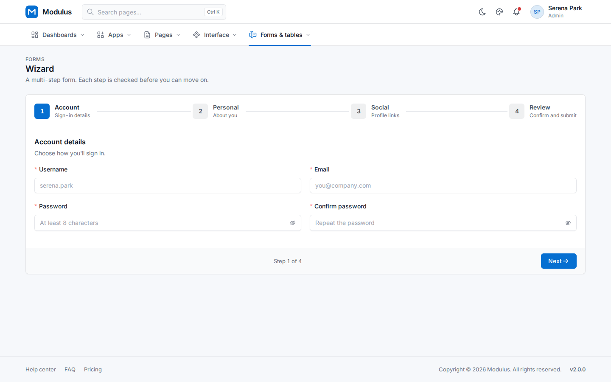
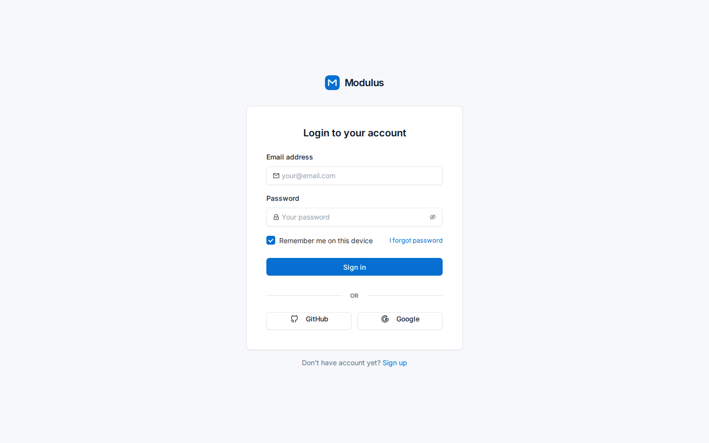

# Modulus UI

Admin-panel UI for **Blazor**, **ASP.NET Core MVC** and **Razor Pages**, built on
[Ant Design Blazor](https://antblazor.com) 1.6.2 and its official Pro layout, on .NET 10.

One theme, one menu definition and one set of design tokens produce the same [Tabler](https://tabler.io/admin-template)-style
admin template in every flavor. Blazor uses the real Ant Design Blazor components. MVC and Razor Pages use tag helpers that
emit the same Ant Design DOM, with htmx and Alpine.js for interactivity. The three sample apps render the same 44 pages,
pixel-for-pixel where the controls allow it.

| Blazor — analytics dashboard | MVC — eCommerce dashboard (dark) |
|---|---|
|  |  |
| **Razor Pages — kanban** | **Blazor — data table (dark)** |
|  |  |
| **MVC — form wizard** | **Razor Pages — sign-in** |
|  |  |

## What you get

- **Every Ant Design Blazor component**, as-is. Modulus adds thin `App*` aliases (`AppButton : AntDesign.Button`),
  so every upstream parameter works and new ones arrive automatically on upgrade. The coverage manifest lists 90 aliases;
  CI verifies them against the pinned AntDesign package.
- **Tabler-style shell**: header with page search (Ctrl K), notifications and account menu; a horizontal navbar or a
  vertical sidebar, boxed or fluid width and a light or dark nav, all switchable in a settings panel and remembered in
  cookies; footer; light/dark mode with no flash on load. One renderer (`ShellRenderer`) produces the markup for
  Blazor's `AppShell` and MVC's `_ModulusLayout`. The Ant Design Pro `ModulusLayout` is still available for Blazor.
- **Pro components** following ProComponents conventions: `ProTable` (server paging, sorting, selection and batch actions,
  density, reload), `QueryFilter` (collapsible search form), `ModalForm` / `DrawerForm` (validated, async submit),
  `StatisticCard` + `Trend`, `FooterToolbar`.
- **Editable grid** (`EditableGrid` / `app-editable-grid`): columns are data (`GridColumn`: text, number, currency,
  percent, select, multi-select, tag, date, switch, progress, rating). Cells edit in place with the matching control
  and are validated; rows expand into a detail template; columns pin left or right, hide, reorder and are added or
  removed at run time. Blazor and MVC share one schema, formatter and validator (`GridSchema`).
- **Charts with no JS dependency**: `LineChart` (line/area, crosshair tooltip), `ColumnChart` (grouped/stacked),
  `BarChart`, `DonutChart`, `HeatmapChart`, `Sparkline`, `MiniBar`. The geometry is shared by Blazor and MVC,
  hover tooltips are CSS-only, and each chart carries a screen-reader data table.
- **Ant Design 5 components that AntD Blazor 1.6.2 lacks**, in both flavours: `AppQRCode` / `app-qr-code` (a tested QR
  encoder, drawn as SVG, with icon and status overlays), `AppColorPicker` / `app-color-picker` (palette, hue and alpha
  sliders, hex/RGB input, presets, clear), `AppFloatButton` / `AppFloatButtonGroup` / `AppFloatBackTop` and
  `AppTour` / `app-tour` (spotlight mask, placement with flipping, keyboard).
- **Theming from one options object**: primary, success, warning, error and info colours plus border radius.
  The 10-step palette is generated with a C# port of `@ant-design/colors` (tested against the official palettes).
  Light/dark mode persists in a cookie, so the server renders the correct theme on the first byte.
- **MVC / Razor Pages parity**: the same layout (`_ModulusLayout`), menu, header, theme toggle, drawer, confirm dialog
  and toast messages, driven by `Response.HxMessage()`, `HxCloseDrawer()` and `HxTrigger()`.
- **Full Ant Design markup for MVC**: 80+ tag helpers render the same DOM as Ant Design Blazor, so one stylesheet
  styles both flavours. Interactive pieces (tabs, dropdowns, collapse, modal, upload, rate) use small Alpine
  components with keyboard support. They need no build step.
- **Responsive shell**: below 992 px the navigation moves behind a menu button that slides the sidebar in as a drawer.
  Wide tables and segmented controls scroll inside their card instead of widening the page.
- **Three complete sample admin apps** (Blazor, MVC and Razor Pages) with the same pages and URLs:
  - **Dashboards**: analytics, CRM, eCommerce.
  - **Apps**: email, chat, calendar, kanban, invoices (list, preview, add, edit), users (list, view), roles,
    permissions, customers CRUD, eCommerce products and orders.
  - **Pages**: profile, account settings, pricing, FAQ, help center; sign-in, register, forgot/reset password,
    verify email, two-step verification; 404, 403, 500, maintenance and coming soon.
  - **Interface, forms and tables**: component gallery (every Ant Design category), cards, charts, form layouts,
    a validated multi-step wizard, a validation showcase, and a data table (search, filters, sorting, paging,
    column picker, density, selection and CSV export).

## Quick start — Blazor

```csharp
// Program.cs
builder.Services.AddRazorComponents().AddInteractiveServerComponents();
builder.Services.AddModulusBlazor(theme =>
{
    theme.Title = "Contoso ERP";
    theme.PrimaryColor = "#1677ff";
});
builder.Services.AddTransient<IMenuContributor, AppMenuContributor>();
```

```razor
@* App.razor <head> *@
<ModulusHead />
@* before </body> *@
<script src="_content/AntDesign/js/ant-design-blazor.js"></script>

@* Routes.razor — once, after the Router *@
<AntContainer />

@* MainLayout.razor — the Tabler shell (or <ModulusLayout> for the Ant Design Pro BasicLayout) *@
<AppShell>@Body</AppShell>
```

```csharp
public sealed class AppMenuContributor : IMenuContributor
{
    public Task ConfigureMenuAsync(MenuConfigurationContext context)
    {
        context.Add(new MenuItemDefinition("dashboard", "Dashboard", "", "dashboard") { Order = 0, ExactMatch = true })
               .Add(new MenuItemDefinition("customers", "Customers", "customers", "team") { Order = 10, RequiredPolicy = "Customers.Read" });
        return Task.CompletedTask;
    }
}
```

A page:

```razor
<PageContainer Title="Customers">
    <ProTable TItem="Customer" HeaderTitle="Customer list" RowKey="c => c.Id" Request="LoadAsync">
        <Columns>
            <PropertyColumn Property="c => c.Name" Sortable />
            <PropertyColumn Property="c => c.Company" />
        </Columns>
    </ProTable>
</PageContainer>

@code {
    private Task<ProTableResponse<Customer>> LoadAsync(ProTableRequest request) =>
        Task.FromResult(_customers.SortBy(request, "Name", c => c.Name).ToPage(request));
}
```

See `samples/Modulus.AdminTemplate.Blazor/Components/Pages/Apps/Customers/CustomerList.razor` for the full pattern:
filter, table, batch delete and drawer form.

## Quick start — MVC / Razor Pages

```csharp
builder.Services.AddControllersWithViews();   // or AddRazorPages()
builder.Services.AddModulusMvc(theme => theme.Title = "Contoso ERP");
builder.Services.AddTransient<IMenuContributor, AppMenuContributor>();
```

```cshtml
@* _ViewImports.cshtml *@
@addTagHelper *, Modulus.AspNetCore.Mvc

@* _ViewStart.cshtml *@
@{ Layout = "_ModulusLayout"; }
```

```cshtml
<app-page-container title="Customers">
  <app-card title="Customer list">
    <app-card-extra>
      <app-button type="primary" icon="plus" hx-get="/customers/new" hx-target="#modulus-drawer-body"
                  x-on:click="$store.drawer.show('New customer')">New customer</app-button>
    </app-card-extra>
    <div id="table" hx-get="/customers/table" hx-trigger="load, customers:refresh from:body"></div>
  </app-card>
</app-page-container>
```

```csharp
// Controller, after a successful save:
Response.HxMessage(MessageType.Success, $"Created {customer.Name}");
Response.HxCloseDrawer();
Response.HxTrigger("customers:refresh");
return NoContent();
```

Tag helpers. `/ui/components` in the MVC and Razor Pages samples shows each one; the Blazor sample shows its twin at the same URL:

| Category | Tag helpers |
|---|---|
| General | `app-button` (`loading`), `app-icon`, `app-title`, `app-text`, `app-paragraph`, `app-link`, `app-float-button`, `app-float-button-group` (click/hover trigger), `app-float-back-top` |
| Layout | `app-divider`, `app-space`, `app-row` / `app-col` (24-column grid, gutters, xs–xxl), `app-flex`, `app-layout` / `app-layout-header` / `app-layout-sider` / `app-layout-content` / `app-layout-footer`, `app-splitter` / `app-splitter-panel` (drag and arrow keys) |
| Navigation | `app-breadcrumb`, `app-tabs` / `app-tab`, `app-steps` / `app-step`, `app-dropdown` / `app-dropdown-item`, `app-dropdown-button`, `app-menu` / `app-sub-menu` / `app-menu-item` / `app-menu-divider` (horizontal, vertical, inline), `app-pagination` (htmx or plain links), `app-anchor` / `app-anchor-link` (scroll-spy), `app-affix`, `app-back-top` |
| Data entry | `app-form-item` (`asp-for` + validation), `app-input` (affixes, addons, clear, password, datalist AutoComplete), `app-input-search`, `app-textarea` (count), `app-input-number`, `app-select`, `app-date-picker` (date/week/month/time), `app-range-picker`, `app-checkbox`, `app-checkbox-group`, `app-radio-group`, `app-switch`, `app-slider`, `app-rate`, `app-segmented`, `app-upload`, `app-cascader`, `app-tree-select`, `app-transfer`, `app-auto-complete`, `app-mentions`, `app-input-group` (compact), `app-color-picker` (hex/rgb, alpha, presets, clear) |
| Data display | `app-card` (`app-card-cover`, `app-card-meta`, `app-card-action`), `app-comment` / `comment-action`, `app-countdown`, `app-image-group` (shared preview), `app-avatar` / `app-avatar-group`, `app-badge` / `app-badge-ribbon`, `app-tag`, `app-statistic`, `app-descriptions`, `app-table` (`hidden-columns`, `density`, `scroll-x`, `table-footer`), `app-table-columns` (column picker), `app-table-settings` (reload, density), `app-list`, `app-timeline`, `app-collapse` / `app-panel`, `app-image`, `app-tooltip`, `app-popover`, `app-empty`, `app-tree` (checkable), `app-calendar`, `app-carousel` / `carousel-slide`, `app-qr-code` (icon, status), `app-tour` / `tour-step` |
| Feedback | `app-alert`, `app-progress` (line/circle/dashboard), `app-result`, `app-skeleton`, `app-spin`, `app-modal`, `app-drawer` (right/left/top/bottom), `app-watermark`; plus `Response.HxMessage`, `HxNotify`, `HxCloseModal` and `hx-confirm` |
| Pro | `app-page-container`, `app-page-header`, `app-statistic-card`, `app-trend`, `app-editable-grid` (`grid-toolbar`, `grid-title-extra`, `grid-summary`; read posts with `EditableGridForm.Read` / `Apply`) |
| Charts | `app-line-chart`, `app-column-chart`, `app-bar-chart`, `app-donut-chart`, `app-heatmap`, `app-sparkline`, `app-mini-bar` |
| Icons | `app-icon` (Ant Design), `app-ti` (Tabler sprite, 270+ icons) |

Controls bind with `asp-for` (name, id, value and validation state) or a plain `name`. Any other attributes you add,
such as `placeholder`, `hx-*` or `x-*`, go to the real `<input>`. Forms stay plain HTML and post normally.

## Theme options

Bind the options from configuration or set them in code:

```json
"Modulus": { "Theme": { "Title": "Modulus Admin", "PrimaryColor": "#1677ff", "BorderRadius": 6,
                        "DefaultMode": "Light", "NavTheme": "Light" } }
```

| Option | Default | |
|---|---|---|
| `Title`, `LogoUrl` | "Modulus Admin", built-in mark | Sider header |
| `PrimaryColor`, `SuccessColor`, `WarningColor`, `ErrorColor`, `InfoColor` | antd v5 palette | 10-step palettes generated server-side |
| `BorderRadius` | 6 | Controls, cards, menus (sm/lg derived) |
| `DefaultMode` | `Light` | `Light`, `Dark` or `System`; the user's choice is stored in the `modulus-theme` cookie |
| `NavTheme` | `Light` | Sider theme |
| `SiderWidth`, `HeaderHeight` | 208, 56 | Ant Design Pro defaults |

## Projects

| Project | Purpose |
|---|---|
| `src/Modulus.Ui.Abstractions` | Flavor-agnostic: theme options and palette generation, menu contributors, `ProTableRequest/Response`, chart geometry |
| `src/Modulus.Ui.Assets` | `modulus.css` design layer, `modulus-theme.js`, `modulus-mvc.js`, vendored htmx 2.0.11 and Alpine.js 3.17.4 |
| `src/Modulus.Blazor` | `AddModulusBlazor`, `App*` aliases, ProLayout shell, Pro components, charts (no server framework dependency, so it is WASM-compatible) |
| `src/Modulus.AspNetCore.Mvc` | `AddModulusMvc`, tag helpers, `_ModulusLayout` and partials, htmx response helpers, `AntIcons` |
| `samples/Modulus.AdminTemplate.*` | The Blazor, MVC and Razor Pages admin templates |
| `samples/Modulus.Samples.Shared` | Models, in-memory stores, menu and page data shared by all three samples |
| `samples/Modulus.Samples.Web` | Page bodies (`Views/Shared/Ui/**`) shared by MVC and Razor Pages: controllers and page models only bind input and pick the view |
| `tests/*` | bUnit component tests, palette/menu/table/chart unit tests, tag helper and icon tests |
| `tools/antd-drift` | Checks the manifest and aliases against the pinned AntDesign package (see [UPGRADING](docs/UPGRADING.md)) |

## Build, test, run

```bash
dotnet build Modulus.slnx
dotnet test --solution Modulus.slnx
dotnet run --project tools/antd-drift

dotnet run --project samples/Modulus.AdminTemplate.Blazor       # http://localhost:5100
dotnet run --project samples/Modulus.AdminTemplate.Mvc          # http://localhost:5101
dotnet run --project samples/Modulus.AdminTemplate.RazorPages   # http://localhost:5102
```

Run the samples in the **Development** environment (the default launch profile does this) or publish them;
`dotnet run` in Production does not serve library static assets.

## Known limitations

- **Ant Design Blazor 1.6 ships antd v4 styling.** Modulus adds a v5-style refresh layer (6 px radius, softer shadows,
  v5 menu and table styling) over it. The result looks like modern Ant Design Pro, but it is not pixel-identical to antd v5.
- **Brand colour in dark mode.** `PrimaryColor` drives the light theme. AntDesign's dark stylesheet hard-codes antd blue,
  so dark mode stays blue until AntDesign ships a variable-based dark theme.
- **Icons in MVC** reuse Ant Design Blazor's icon store through reflection, because the API is internal. A unit test fails
  if an AntDesign upgrade moves it.
- **Interactive MVC widgets need Alpine.** Cascader, TreeSelect, Transfer, Tree, Calendar, Carousel, Anchor, Mentions,
  Splitter, ColorPicker, Tour and the rest run on small Alpine components (`modulus-widgets.js`); form widgets post
  through hidden inputs, so forms still submit without script. The manifest lists the MVC equivalent for every component.
- **ColorPicker, FloatButton, QRCode and Tour are Modulus components**, not AntD Blazor ones (1.6.2 has none). They emit
  the antd v5 DOM, styled by `modulus.css`, and may differ in detail from antd v5.
- **Native pickers in MVC.** `app-date-picker` and `app-range-picker` use the browser's date/time inputs inside antd chrome,
  so the calendar popup follows the browser, not antd.
- **Authorization** is wired for menus (`RequiredPolicy`). The sample sign-in page is a demo and does not authenticate.

## Documentation

- [docs/DESIGN.md](docs/DESIGN.md): design decisions and the analysis of other Ant Design-based libraries they come from
- [docs/UPGRADING.md](docs/UPGRADING.md): upgrading AntDesign, htmx and Alpine.js safely
- `manifest/antd-coverage.json`: component-by-component coverage, verified in CI
